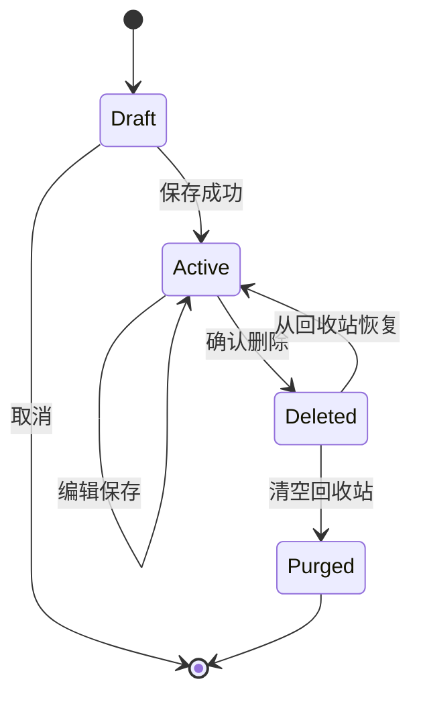

# 数据生命周期

> 用途说明：定义数据从创建、保存、修改、删除、恢复、备份、迁移到永久清除的状态和安全规则。
>
> 状态：初稿 / 待评审
>
> 最后更新日期：2026-07-30

## 1. 目标

- 防止保存失败和级联删除造成无提示数据丢失。
- 让用户能够理解数据当前状态及恢复可能性。
- 明确软删除、永久删除和物理安全删除的区别。
- 保证迁移、备份和恢复不会破坏有效保险库。
- 将短生命周期明文与长期加密数据分开管理。

## 2. 生命周期概览

`Draft` 是应用会话中的编辑状态，不是独立持久化实体。`Deleted` 和 `Purged` 的具体物理表示由数据库设计确定。

## 3. 初始删除策略

为了降低密码数据误删风险，采用以下初始决策：

- 分类、网站和账号使用软删除。
- 软删除对象进入本地回收站，不自动定时清空。
- 用户主动清空回收站后，对象进入永久删除状态。
- 单个账号字段在编辑草稿中删除，保存前可以撤销；保存成功后不单独进入回收站。
- 删除父对象时，其子对象作为同一个删除批次一起进入回收站。
- 恢复父对象时，恢复同批次删除且关系仍有效的子对象。

该方案增加少量生命周期元数据，但能避免简单误操作造成不可恢复损失。

## 4. 创建

创建流程：

1. 应用生成稳定标识。
2. 在内存草稿中完成输入和校验。
3. 领域层验证父对象、名称、字段和敏感规则。
4. 数据层在一个事务中写入完整对象。
5. 成功提交后才向用户显示“保存成功”。

失败规则：

- 不持久化半个账号或部分字段。
- 不复用失败创建留下的标识，除非实现保证其安全。
- 错误日志不包含字段值。

## 5. 读取

- 只有 DPAPI/SQLCipher 文件对验证并成功打开后才读取业务内容。
- 读取到不支持的数据版本时进入只读或升级流程，不直接覆盖。
- 读取到关系损坏时停止相关写入并提供恢复信息。
- 敏感字段的明文只在所需范围内进入内存。
- 对象切换、组件卸载和应用退出时清理当前详情、搜索结果与临时敏感状态。

## 6. 修改

- 编辑在内存草稿中进行。
- 用户确认保存前不改变持久化数据。
- 账号和字段作为一次原子保存。
- 更新成功后修改 `updatedAt`。
- 写入失败时保留最后一个有效持久化版本。
- MVP 不实现多设备并发；同进程多个编辑视图仍需避免后保存覆盖先保存而无提示。

## 7. 软删除

软删除至少记录：

- `deletedAt`。
- `deletionGroupId`。
- 删除对象类型和标识。
- 恢复所需的原父关系。

删除批次用于区分：

- 原本已经在回收站中的子对象。
- 因本次父对象删除而一起删除的子对象。

示例：删除网站时，网站、其账号和字段属于同一删除批次；恢复网站时只恢复本批次包含的对象。

## 8. 删除影响

### 8.1 分类

- 删除前显示网站和账号数量。
- 确认后分类及其网站、账号和字段进入同一删除批次。
- 也可以在删除前把网站移动到其他分类。

### 8.2 网站

- 删除前显示账号数量。
- 确认后网站、账号和字段进入同一删除批次。

### 8.3 账号

- 删除前显示账号名称。
- 确认后账号及字段进入同一删除批次。
- 同网站其他账号不受影响。

### 8.4 字段

- 编辑期间删除可在保存前撤销。
- 保存后字段从活跃账号结构中移除。
- 如果账号整体处于回收站，其字段随账号恢复。

## 9. 回收站

首个公开版本应提供：

- 查看已删除分类、网站和账号。
- 显示删除时间和原归属。
- 恢复单个删除批次。
- 清空回收站。
- 永久删除前再次确认。

内部 MVP 可以先实现底层软删除和基础恢复测试，回收站完整界面进入公开版本。

回收站内容仍然是保险库的一部分，继续受到加密保护。

## 10. 恢复

恢复前验证：

- 原父对象存在或可同时恢复。
- 恢复不会造成不允许的同名冲突。
- 对象标识没有被其他活跃对象占用。
- 数据版本受支持。

冲突处理：

- 默认不静默重命名。
- 用户可选择修改显示名称或恢复到其他有效父对象。
- 稳定标识原则上保持不变。

## 11. 永久删除

永久删除意味着：

- 对象不再出现在正常查询和回收站中。
- 数据库逻辑记录按设计清除或压缩。
- 加密备份中的旧副本不会自动删除。
- SSD、文件系统日志、系统备份或磁盘快照中可能仍有历史数据。

因此界面和文档不能承诺“物理上绝对不可恢复”。对于加密保险库，销毁相关密钥材料是重要保护手段，但具体能力由加密设计决定。

## 12. 保险库删除

普通 MVP 界面不提供删除整个保险库。

未来如果提供：

- 明确显示完整影响。
- 要求重新验证主密码。
- 建议先创建备份。
- 关闭应用并释放文件句柄后执行。
- 提醒用户其他备份副本不受影响。

卸载应用默认不删除保险库。卸载数据必须是独立、明确且可取消的选择。

## 13. 备份

- 备份用于恢复，不等同于导出。
- 备份保持加密保护。
- 创建后执行完整性检查。
- 备份文件包含恢复所需的数据版本信息。
- 备份失败不影响当前有效保险库。
- 用户选择备份位置，并得到明确结果。

回收站内容是否进入备份：

- 默认包含，以便完整恢复。
- 恢复后仍保持删除状态。
- 备份界面应说明这一点。

## 14. 恢复备份

恢复采用安全替换流程：

1. 读取并验证备份头和完整性。
2. 检查数据版本。
3. 在临时位置完成解密和结构验证。
4. 保留当前保险库的恢复点。
5. 原子替换或切换到恢复结果。
6. 再次验证能够解锁和读取。
7. 成功后清理临时明文和无效临时文件。

任何一步失败都不得覆盖当前有效保险库。

## 15. 数据迁移

- 迁移前创建可恢复副本。
- 使用新文件或事务完成转换。
- 验证实体数量、父子关系、字段角色和完整性。
- 成功后才更新数据版本。
- 失败时保持原版本可恢复。
- 新版本应用不得让旧版本无提示重写未知数据。

## 16. 临时数据

| 临时内容 | 生命周期 |
| --- | --- |
| DPAPI 解开的数据库密钥 | SQLCipher 打开所需范围，随后尽快释放可控副本 |
| 解密字段值 | 当前操作所需时间 |
| 显示密码状态 | 当前详情组件，切换对象或重启时清除 |
| 搜索结果 | 当前搜索交互 |
| 剪贴板内容 | 用户复制后到清除或被覆盖 |
| 编辑草稿 | 保存、取消、组件卸载或退出前 |
| 恢复临时文件 | 恢复完成或失败清理时 |

语言运行时可能复制字符串，不能承诺所有内存立即擦除；此限制必须在敏感数据处理文档说明。

## 17. 数据保留

- 活跃数据由用户决定保留时间。
- 回收站默认无限期保留，直到用户清空。
- 应用不自动上传或远程保存备份。
- 普通日志采用短期轮转并禁止秘密。
- 崩溃信息不得包含解密对象。
- 不记录“最近使用”或访问历史，除非用户明确启用未来功能。

## 18. 验收标准

- [ ] 创建失败不会产生被误认为有效的半成品对象。
- [ ] 账号和字段修改原子保存。
- [ ] 级联删除前显示影响。
- [ ] 父子对象使用同一删除批次。
- [ ] 恢复不会复活删除批次之外的对象。
- [ ] 永久删除明确说明备份和存储介质限制。
- [ ] 备份恢复失败不会覆盖当前保险库。
- [ ] 卸载默认保留保险库。
- [ ] 对象切换、组件卸载和退出时清理临时详情与搜索状态。

## 19. 待决策事项

- [ ] 技术设计确认 `deletionGroupId` 的物理表示。
- [ ] 确定内部 MVP 是否提供简化回收站界面。
- [ ] 确定永久删除后数据库压缩时机。
- [ ] 确定恢复名称冲突的最终交互。
- [x] 按 ADR-014 排除自动锁定；编辑草稿只保留在当前前端组件内，不持久化。

## 20. 相关文档

- [数据模型](DATA_MODEL.md)
- [实体定义](ENTITY_DEFINITIONS.md)
- [数据验证](DATA_VALIDATION.md)
- [元数据](METADATA.md)
- [备份与恢复](../03-storage/BACKUP_AND_RESTORE.md)
