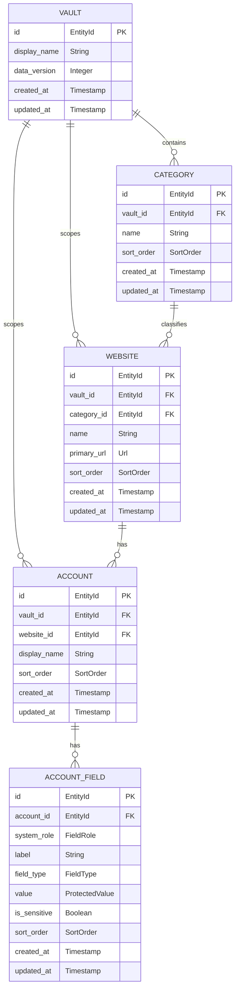
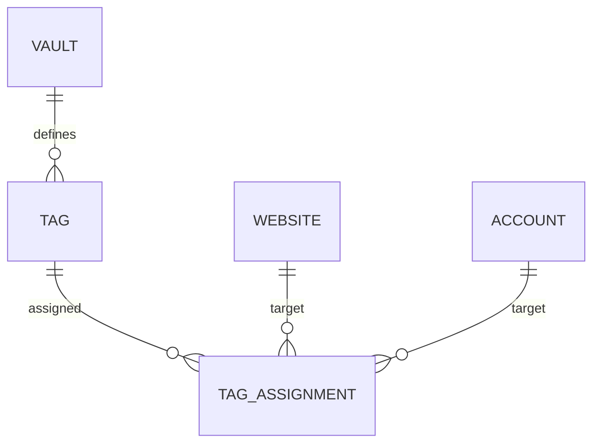

# 数据模型

> 用途说明：定义与具体数据库无关的逻辑数据结构、字段、关系、约束、敏感级别和版本演进要求，为数据库结构和迁移设计提供依据。
>
> 状态：初稿 / 待评审
>
> 最后更新日期：2026-07-30

## 1. 设计目标

- 支持一个网站下多个账号。
- 使用统一字段结构表达基础字段和自定义字段。
- 保持对象标识稳定，不依赖名称或界面位置。
- 支持安全持久化、事务、备份和版本迁移。
- 明确敏感数据和普通元数据的边界。
- 支持未来增加标签、模板和多保险库，而不破坏 MVP 数据。

本文件描述逻辑模型，不决定使用关系型数据库、文档数据库或具体加密方式。

## 2. 逻辑模型概览

`vault_id` 在网站和账号上的冗余范围标识属于建议设计。它可以强化跨保险库隔离和查询约束，但是否在物理结构保留，需要数据库设计评审。

## 3. 通用字段约定

所有核心实体建议包含：

| 字段 | 含义 | 规则 |
| --- | --- | --- |
| `id` | 稳定内部标识 | 创建后不可修改，不向用户要求手工输入 |
| `created_at` | 创建时间 | 创建时写入，后续不修改 |
| `updated_at` | 最后更新时间 | 成功修改后更新 |
| `data_version` 或全局版本 | 数据格式版本 | 用于迁移和兼容检查 |

可选生命周期字段：

| 字段 | 含义 | 状态 |
| --- | --- | --- |
| `deleted_at` | 软删除时间 | 分类、网站和账号采用 |
| `revision` | 乐观并发版本 | MVP 不采用，由应用层检测编辑覆盖 |

时间统一存储为明确时区的机器可比较格式，界面根据本地时区显示。具体表示由数据库规范确定。

## 4. 实体结构

### 4.1 Vault

| 字段 | 必填 | 敏感级别 | 说明 |
| --- | --- | --- | --- |
| `id` | 是 | 普通元数据 | 保险库标识 |
| `display_name` | 是 | 普通或私密元数据 | MVP 可使用默认名称 |
| `data_version` | 是 | 普通元数据 | 逻辑数据格式版本 |
| `created_at` | 是 | 私密元数据 | 创建时间 |
| `updated_at` | 是 | 私密元数据 | 更新时间 |

不属于该实体普通字段：

- 主密码。
- 明文派生密钥。
- 明文数据加密密钥。
- 可直接绕过主密码的恢复秘密。

安全头信息、盐、密钥派生参数和被包装的密钥材料属于保险库文件安全结构，由加密设计定义，不能与普通领域字段混为一谈。

### 4.2 Category

| 字段 | 必填 | 敏感级别 | 说明 |
| --- | --- | --- | --- |
| `id` | 是 | 普通元数据 | 分类标识 |
| `vault_id` | 是 | 普通元数据 | 所属保险库 |
| `name` | 是 | 私密数据 | 用户定义名称 |
| `sort_order` | 是 | 私密元数据 | 同级排序 |
| `created_at` | 是 | 私密元数据 | 创建时间 |
| `updated_at` | 是 | 私密元数据 | 更新时间 |

约束：

- 名称去除无意义首尾空白后不能为空。
- 分类不能跨保险库引用。
- 名称在保险库内使用规范化比较键保持唯一。

### 4.3 Website

| 字段 | 必填 | 敏感级别 | 说明 |
| --- | --- | --- | --- |
| `id` | 是 | 普通元数据 | 网站标识 |
| `vault_id` | 建议 | 普通元数据 | 所属保险库范围 |
| `category_id` | 是 | 普通元数据 | 所属分类 |
| `name` | 是 | 私密数据 | 网站或服务名称 |
| `primary_url` | 否 | 私密数据 | 主网址 |
| `icon_ref` | 否 | 私密元数据 | MVP 可为空或使用默认图标 |
| `sort_order` | 是 | 私密元数据 | 分类内排序 |
| `created_at` | 是 | 私密元数据 | 创建时间 |
| `updated_at` | 是 | 私密元数据 | 更新时间 |

约束：

- 网站名称不能为空。
- 分类必须存在且属于同一保险库。
- 网址为空时不能执行打开操作。
- 网址验证和允许协议由值对象及网址启动模块共同实施。

网站备注不进入 MVP 最小模型；如果后续需要，可使用网站字段扩展或新增明确属性，不能临时写入图标或网址字段。

### 4.4 Account

| 字段 | 必填 | 敏感级别 | 说明 |
| --- | --- | --- | --- |
| `id` | 是 | 普通元数据 | 账号标识 |
| `vault_id` | 建议 | 普通元数据 | 所属保险库范围 |
| `website_id` | 是 | 普通元数据 | 所属网站 |
| `display_name` | 是 | 私密数据 | 例如“私人账号” |
| `sort_order` | 是 | 私密元数据 | 网站内排序 |
| `created_at` | 是 | 私密元数据 | 创建时间 |
| `updated_at` | 是 | 私密元数据 | 更新时间 |

约束：

- 网站必须存在。
- 显示名称去除无意义首尾空白后不能为空。
- 同一网站可以存在多个账号。
- 修改显示名称不影响字段或归属。
- 账号本身不直接增加 `username`、`password` 等固定列，这些内容使用统一账号字段表示。

### 4.5 AccountField

| 字段 | 必填 | 敏感级别 | 说明 |
| --- | --- | --- | --- |
| `id` | 是 | 普通元数据 | 字段标识 |
| `account_id` | 是 | 普通元数据 | 所属账号 |
| `system_role` | 否 | 私密元数据 | `username`、`password`、`email`、`note` 或空 |
| `label` | 是 | 私密数据 | 用户可见名称 |
| `field_type` | 是 | 私密元数据 | 字段语义类型 |
| `value` | 否 | 受保护数据 | 字段实际值 |
| `is_sensitive` | 是 | 私密元数据 | 默认展示和复制保护依据 |
| `sort_order` | 是 | 私密元数据 | 账号内顺序 |
| `created_at` | 是 | 私密元数据 | 创建时间 |
| `updated_at` | 是 | 私密元数据 | 更新时间 |

约束：

- 字段必须属于存在的账号。
- 标签去除无意义首尾空白后不能为空。
- `password` 系统角色必须强制敏感。
- 同一个账号中，每种非空系统角色最多一个，除非后续通过明确决策允许多个。
- 自定义字段的 `system_role` 为空。
- 未知 `field_type` 必须能够保留原始值和类型标识。
- 字段排序在同一账号内稳定。

## 5. 基础字段统一模型

建议不在 `Account` 上建立 `username`、`password`、`email` 和 `note` 固定数据列，而是在创建账号时生成具有系统角色的 `AccountField`：

| 系统角色 | 默认标签 | 类型 | 默认敏感 |
| --- | --- | --- | --- |
| `username` | 用户名 | text | 否 |
| `password` | 密码 | password | 是 |
| `email` | 邮箱 | email | 否 |
| `note` | 备注 | multiline | 否，但仍视为受保护数据 |

好处：

- 基础字段与自定义字段共用排序、复制、校验和持久化逻辑。
- 用户可以调整显示标签，而不丢失系统语义。
- 未来增加字段类型时不需要不断增加账号列。
- 一个统一的字段模块更符合模块化原则。

代价：

- 查询用户名等常用字段需要按角色查找。
- 唯一角色和排序约束需要更严格的验证。
- 搜索策略必须区分系统角色、敏感属性和实际值。

该方案是当前建议，需要在数据库设计前通过架构决策记录确认。

## 6. 标识策略

逻辑要求：

- 全局或保险库内唯一。
- 创建后稳定。
- 不包含用户敏感信息。
- 不按分类层级或数组位置编码。
- 可以在导入、迁移和备份中保持。

具体采用 UUID、ULID、随机字节或其他格式，由技术栈和数据库设计决定。不得使用分类名、网址或用户名作为主键。

## 7. 排序模型

具有用户顺序的对象使用 `sort_order`：

- 分类在保险库内排序。
- 网站在分类内排序。
- 账号在网站内排序。
- 字段在账号内排序。

MVP 可以自动生成整数顺序。重新排序时必须：

- 只影响同一父对象内的同级对象。
- 保持确定性。
- 在写入失败时避免出现部分顺序更新。

稀疏排序、分数索引或批量重排由数据库和性能设计决定。

## 8. 敏感性分类

为避免“没标记敏感就可以公开”的误解，所有保险库业务内容默认都受存储加密保护。`is_sensitive` 主要控制界面和运行时行为。

| 级别 | 示例 | 存储保护 | 界面默认 |
| --- | --- | --- | --- |
| 秘密值 | 密码、Token、恢复码 | 必须保护 | 隐藏 |
| 私密数据 | 用户名、邮箱、网址、备注、分类名 | 必须保护 | 可见 |
| 私密元数据 | 时间、排序、字段类型、对象关系 | 原则上保护 | 按需显示 |
| 必要安全头信息 | 盐、版本、算法参数等 | 完整性保护，是否加密由安全设计决定 | 不显示 |

敏感级别不直接决定物理加密边界，最终以加密设计为准。

## 9. 搜索数据模型

MVP 不要求建立持久化搜索实体。

建议流程：

1. 保险库成功解锁。
2. 从受保护数据源读取允许搜索的字段。
3. 在当前会话内完成匹配。
4. 返回只包含对象标识和安全摘要的结果。
5. 锁定时清理搜索状态。

默认允许搜索：

- 分类名称。
- 网站名称。
- 账号显示名称。
- `username` 和 `email` 角色的非敏感字段。
- 明确标记为可搜索的非敏感自定义字段，是否进入 MVP 待决策。

默认禁止持久化明文索引：

- 密码。
- Token。
- 恢复码。
- 标记为敏感的自定义字段。

## 10. 删除与生命周期

逻辑模型必须能够表达：

- 活跃。
- 已删除但可恢复。
- 已永久删除。

采用 `deleted_at` 与删除批次实现软删除。内部 MVP 至少实现底层删除与恢复测试，完整回收站界面进入公开版本。

无论采用哪种方案：

- 删除分类前必须处理其网站。
- 删除网站前必须处理其账号和字段。
- 删除账号前必须处理其字段。
- 不能留下可被正常查询到的孤立子对象。
- “永久删除”不能承诺物理介质绝对不可恢复。

## 11. 标签与收藏扩展

标签和收藏不进入 MVP 核心表，但逻辑扩展建议如下：

在关系型数据库中，多态目标可能削弱外键完整性。物理设计时应在以下方案中选择：

- 网站标签和账号标签使用独立关联表。
- 使用统一资源标识和资源注册表。
- 第一版只允许一种对象使用标签。

收藏建议采用独立偏好或关联结构，而不是直接改变分类关系。目标对象范围仍待产品决策。

## 12. 模板扩展

未来模板只描述默认字段结构：

- 模板标识和名称。
- 字段定义列表。
- 默认标签、类型、敏感属性和顺序。

使用模板创建账号后，实际字段应成为账号自己的数据副本。删除或修改模板不能破坏已经创建的账号。

## 13. 版本与迁移

- 数据必须具有可识别的格式版本。
- 应用必须在写入前判断是否支持该版本。
- 迁移不得静默丢弃未知字段。
- 迁移前应创建或要求可恢复副本。
- 迁移成功后应进行结构和关键关系验证。
- 迁移失败时保留原始数据，并给出可恢复错误。
- 版本号规则由迁移策略文档定义。

## 14. 数据验证

模型层至少验证：

- 必填标识和父对象存在。
- 对象属于同一保险库。
- 名称和字段标签不是空白。
- 网址符合允许格式。
- 系统字段角色约束。
- 密码角色强制敏感。
- 排序只发生在同一父对象范围。
- 未知类型得到保留而不是丢弃。

长度上限、字符规范和同名规则在数据验证文档确定。

## 15. 完整性约束摘要

| 约束 | 结果 |
| --- | --- |
| 删除分类但仍有未处理网站 | 拒绝或进入明确级联流程 |
| 网站引用不存在的分类 | 拒绝 |
| 账号引用不存在的网站 | 拒绝 |
| 字段引用不存在的账号 | 拒绝 |
| 跨保险库父子引用 | 拒绝 |
| 同账号存在两个 `password` 系统角色 | 默认拒绝 |
| 密码角色被标记为非敏感 | 强制敏感或拒绝 |
| 字段类型未知 | 保留，不静默删除 |
| 写入部分成功 | 回滚或报告原子写入失败 |

## 16. 待决策事项

- [x] 确认基础字段和自定义字段使用统一账号字段模型。
- [x] 实体标识使用随机 UUID v4，数据库保存为 16 字节。
- [x] 确定分类、网站、账号和字段标签的同名规则。
- [x] 确定软删除、删除批次和回收站方案。
- [x] 分类、网站和账号物理模型保留 `vault_id` 作为范围约束。
- [x] 时间使用 UTC Unix 毫秒，排序和版本使用整数。
- [x] 自定义字段标签在同一账号内唯一。
- [ ] 确定标签可以作用于哪些对象。
- [ ] 确定搜索允许匹配的非敏感自定义字段。

## 17. 相关文档

- [领域模型](DOMAIN_MODEL.md)
- [实体定义](ENTITY_DEFINITIONS.md)
- [自定义字段系统](CUSTOM_FIELDS.md)
- [数据验证](DATA_VALIDATION.md)
- [数据生命周期](DATA_LIFECYCLE.md)
- [数据库设计](../03-storage/DATABASE_DESIGN.md)
- [数据库结构](../03-storage/DATABASE_SCHEMA.md)
- [加密设计](../04-security/ENCRYPTION_DESIGN.md)
