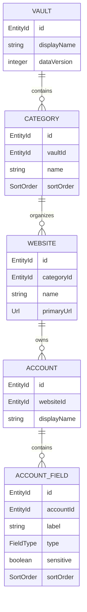
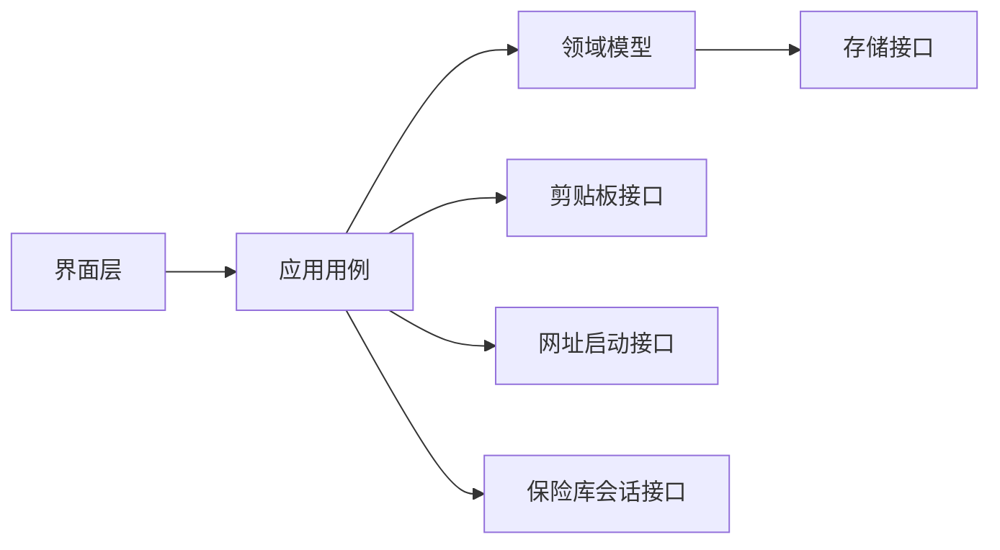

# 领域模型

> 用途说明：从业务角度定义保险库、分类、网站、账号和字段的职责、关系、规则与操作边界，不绑定具体数据库或界面实现。
>
> 状态：初稿 / 待评审
>
> 最后更新日期：2026-07-30

## 1. 模型目标

领域模型需要支持以下核心能力：

- 在一个本地保险库中组织敏感信息。
- 使用分类组织网站。
- 一个网站共享名称和主网址，同时拥有多个相互独立的账号。
- 账号通过统一字段模型保存用户名、密码、邮箱、备注及自定义信息。
- 在不依赖具体页面或数据库表的情况下表达校验、删除和归属规则。
- 为标签、模板、多保险库等未来能力保留演进空间，但不把它们强行加入 MVP。

## 2. 领域边界

当前领域只负责本地账号与敏感信息管理。

领域内部包含：

- 保险库生命周期。
- 分类、网站、账号和字段管理。
- 对象关系和业务校验。
- 敏感属性、显示意图和复制意图。
- 搜索可见范围。

领域外部能力通过服务接口提供：

- 数据加密和持久化。
- 主密码验证和密钥管理。
- 系统剪贴板。
- 系统默认浏览器。
- 本地文件选择和备份位置。
- 界面展示、弹窗和通知。

领域层不能直接调用具体操作系统 API，也不能把“按钮是否可见”当成唯一安全规则。

## 3. 核心关系

MVP 基本关系：

- 一个保险库包含零个或多个分类。
- 一个分类属于一个保险库。
- 一个分类包含零个或多个网站。
- 一个网站在 MVP 中只属于一个分类。
- 一个网站包含零个或多个账号。
- 一个账号只属于一个网站。
- 一个账号包含零个或多个账号字段。
- 一个字段只属于一个账号。

## 4. 聚合与一致性边界

“聚合”表示一组需要在一次业务操作中保持一致的对象。当前建议：

### 4.1 保险库上下文

保险库是安全和数据隔离边界，但不要求每次修改都重写整个保险库对象。

职责：

- 标识当前数据容器。
- 保存数据格式版本。
- 控制是否处于已解锁应用会话。
- 限制跨保险库引用。

### 4.2 分类聚合

分类负责自己的名称和排序。网站通过分类标识归属，但网站的具体内容不由分类对象直接内嵌保存。

这可以避免重命名分类时重写所有网站，也便于独立查询。

### 4.3 网站聚合

网站是账号的主要业务容器。

需要在网站边界内保证：

- 账号只能属于当前网站。
- 删除网站时能够计算并展示受影响账号。
- 修改共享网址不要求逐个修改账号。

是否在一个事务中连同所有账号一起删除，由数据生命周期设计决定。

### 4.4 账号聚合

账号与其字段构成最重要的一致性边界。

一次账号保存应保证：

- 账号基本信息和字段修改要么一起成功，要么一起失败。
- 字段顺序没有重复冲突。
- 字段不会被错误关联到其他账号。
- 敏感属性与字段值一起持久化。

## 5. 核心实体

### 5.1 保险库

代表受统一安全策略保护的数据容器。

主要行为：

- 创建。
- 请求解锁。
- 锁定。
- 检查数据版本。

主密码和实际加密密钥不作为普通保险库实体字段保存。

### 5.2 分类

代表网站的主要组织方式。

主要行为：

- 创建和重命名。
- 调整排序。
- 查询包含的网站。
- 在删除前计算影响范围。

### 5.3 网站

代表一个网站或在线服务。

主要行为：

- 修改名称和主网址。
- 添加、查看和移除账号。
- 请求打开或复制主网址。

网站不直接保存共享密码。具体身份秘密属于账号字段。

### 5.4 账号

代表网站下的一个具体身份。

主要行为：

- 修改账号显示名称。
- 添加、编辑、排序和移除字段。
- 读取允许展示的字段信息。
- 发起字段显示、隐藏或复制请求。

账号显示名称用于区分“私人”“工作”等用途，不等同于用户名。

### 5.5 账号字段

代表账号上的一项具名信息。

主要行为：

- 修改标签、值、类型和敏感属性。
- 调整顺序。
- 根据敏感属性决定默认展示方式。
- 发起复制请求。

用户名、密码、邮箱和备注采用与自定义字段一致的核心结构，通过系统角色区分，而不是建立完全不同的数据系统。

## 6. 值对象

值对象没有独立生命周期，用于表达和验证特定值。

| 值对象 | 作用 |
| --- | --- |
| `EntityId` | 稳定且不依赖显示名称的对象标识 |
| `DisplayName` | 分类、网站和账号的用户可见名称 |
| `Url` | 经过格式和协议校验的网址 |
| `FieldLabel` | 字段显示名称 |
| `FieldValue` | 字段值；敏感性由字段属性决定 |
| `FieldType` | 文本、密码、邮箱、网址、备注等语义类型 |
| `Sensitivity` | 表示字段是否需要默认隐藏和额外保护 |
| `SortOrder` | 同级对象或字段的稳定显示顺序 |
| `Timestamp` | 创建、更新和删除等时间信息 |
| `DataVersion` | 数据结构或序列化格式版本 |

具体语言类型和数据库表示在后续架构与数据库文档确定。

## 7. 领域规则

### 7.1 标识

- 每个实体具有创建后不改变的稳定标识。
- 重命名对象不得改变标识或关联关系。
- 标识格式不作为用户界面的一部分。
- 不使用数组位置、显示名称或网址充当唯一标识。

### 7.2 名称

- 分类、网站、账号和字段标签不能只包含空白。
- 系统在校验前去除无意义的首尾空白。
- 分类名称在保险库内唯一。
- 同一分类允许同名网站，但创建和编辑时提示用户。
- 账号显示名称在同一网站内唯一。
- 字段标签在同一账号内唯一，系统基础字段角色也必须唯一。

### 7.3 归属

- 对象不能跨保险库引用。
- 网站在 MVP 中必须属于一个分类。
- 账号必须属于一个存在的网站。
- 字段必须属于一个存在的账号。
- 移动网站只改变分类归属，不改变账号和字段。

### 7.4 字段

- 密码角色字段默认敏感。
- 用户可以把自定义字段设为敏感。
- 系统字段角色与用户显示标签分离；把“用户名”改为“登录名”不应失去其角色。
- 一个账号中的系统角色字段至多一个，例如一个主密码字段。
- 未知字段类型必须以兼容方式保留，不能导致整个账号无法读取。

### 7.5 搜索

- 只有保险库解锁后才能查询其内容。
- MVP 搜索网站名称、账号名称和允许搜索的非秘密字段。
- 密码、Token 和敏感字段不进入持久化明文索引。
- 搜索结果不返回敏感值。

### 7.6 复制与打开

- 领域层表达“复制某字段”和“打开某网址”的意图。
- 平台服务执行具体系统操作。
- 锁定状态下，应用层必须拒绝读取并复制字段值。
- 只有经过校验并允许的协议才能发起打开网址请求。

### 7.7 删除

- 删除分类、网站和账号前必须计算影响范围。
- 领域层不得执行无提示的级联删除。
- 分类、网站和账号采用软删除还是立即删除，需通过数据生命周期决策确定。
- 永久删除不等于物理介质上绝对不可恢复。

## 8. 领域操作

| 操作 | 输入 | 成功结果 | 主要失败 |
| --- | --- | --- | --- |
| 创建分类 | 名称、排序 | 新分类 | 名称无效、保险库锁定 |
| 创建网站 | 分类标识、名称、网址 | 新网站 | 分类不存在、名称或网址无效 |
| 移动网站 | 网站标识、目标分类标识 | 归属改变 | 对象不存在、跨保险库 |
| 创建账号 | 网站标识、显示名称 | 新账号 | 网站不存在、名称无效 |
| 保存账号字段 | 账号标识、字段集合 | 账号和字段原子更新 | 字段无效、并发或写入失败 |
| 搜索 | 查询文本、筛选条件 | 不含秘密值的结果 | 保险库锁定、查询无效 |
| 复制字段 | 账号和字段标识 | 复制请求 | 保险库锁定、字段不存在 |
| 打开网站 | 网站标识 | 打开请求 | 网址为空、格式或协议不允许 |
| 删除对象 | 对象标识、确认意图 | 按策略删除 | 对象不存在、未确认、存在受限关系 |

## 9. 领域事件候选

事件用于描述已经发生的事实，是否实际采用事件机制由架构设计决定。

- `VaultCreated`
- `VaultUnlocked`
- `VaultLocked`
- `CategoryCreated`
- `CategoryRenamed`
- `WebsiteCreated`
- `WebsiteMoved`
- `WebsiteUpdated`
- `AccountCreated`
- `AccountUpdated`
- `AccountFieldChanged`
- `EntityDeletionRequested`
- `EntityDeleted`

事件载荷不得包含主密码、明文字段值、Token 或密钥。日志记录事件时也必须遵守这一限制。

## 10. 应用用例与领域对象

- 界面只收集输入和显示结果。
- 应用用例负责权限检查、事务编排和平台调用。
- 领域模型负责业务规则。
- 存储、安全和平台实现通过接口接入。

## 11. MVP 之外的扩展

以下概念不进入 MVP 核心聚合：

- 标签与标签分配。
- 收藏。
- 模板。
- 多保险库。
- 工作区。
- 附件。
- 动态插件。

加入这些能力时必须优先扩展现有关系，而不是改变账号字段的核心语义。

## 12. 关键模型决定

当前初稿采用：

1. 网站在 MVP 中只属于一个分类。
2. 账号是网站的子对象，一个网站支持多个账号。
3. 账号与字段构成原子保存边界。
4. 基础字段和自定义字段共享统一核心模型。
5. 系统字段角色与用户可修改的显示标签分离。
6. 搜索结果不包含敏感值。
7. 模块化不要求动态插件系统。

这些决定在数据库设计前需要完成评审，并在必要时建立架构决策记录。

## 13. 待决策事项

- [x] 分类名唯一；网站可重名但提示；账号名和字段标签在各自父级内唯一。
- [ ] 确定分类删除前移动网站时的默认目标。
- [x] 分类、网站和账号软删除进入回收站，字段随账号保存事务处理。
- [ ] 确定是否允许账号存在多个具有“用户名”语义的字段。
- [ ] 确定并发编辑和冲突处理要求。
- [ ] 确定领域事件是否进入 MVP 架构。
- [ ] 确定收藏最终作用于网站、账号或两者。

## 14. 相关文档

- [术语表](../00-foundation/02-GLOSSARY.md)
- [设计原则](../00-foundation/01-DESIGN_PRINCIPLES.md)
- [产品需求文档](../01-product/PRODUCT_REQUIREMENTS.md)
- [数据模型](DATA_MODEL.md)
- [实体定义](ENTITY_DEFINITIONS.md)
- [自定义字段系统](CUSTOM_FIELDS.md)
- [数据生命周期](DATA_LIFECYCLE.md)
- [模块架构](../05-architecture/MODULE_ARCHITECTURE.md)
