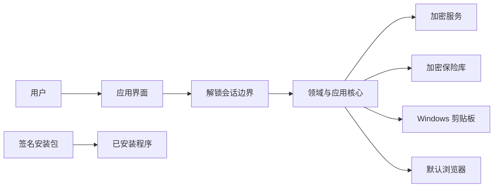

# 安全模型

> 用途说明：定义完全本地桌面应用需要保护的资产、信任边界、安全状态、控制措施、明确限制和公开发布门槛。
>
> 状态：第一阶段内部评审完成 / 公开发布门槛未通过
>
> 最后更新日期：2026-07-30

## 1. 安全定位

本项目是完全运行在用户 Windows 设备上的本地密码与敏感信息管理器：

- 不依赖服务器。
- 不要求在线账号。
- 不提供云同步。
- 不默认联网。
- 不安装后台服务、驱动或浏览器扩展。
- 用户通过一个 Windows `Setup.exe` 安装程序完成安装。

本地运行显著减少了网络服务、远程认证、同步冲突和团队权限带来的攻击面，但保险库仍是高价值目标，因此必须保护本地文件、主密码、解锁内存、剪贴板、备份和安装包。

安全模型追求“范围小、边界清楚、实现成熟”，而不是设计复杂的自有安全协议。

## 2. 安全目标

### 2.1 保密性

- 未掌握主密码时，复制保险库文件不能直接读取账号内容。
- 锁定状态下，正常应用界面和接口不能读取秘密。
- 主密码、密码、Token 和密钥不进入普通日志、配置或崩溃摘要。
- 备份保持加密保护。

### 2.2 完整性

- 保险库被篡改或损坏时能够检测，而不是返回伪造或部分数据。
- 保存、迁移和恢复采用事务或安全替换。
- 安装包和正式发布文件可验证发布者和内容完整性。

### 2.3 可用性与可恢复性

- 正常写入失败不破坏最后一个有效版本。
- 数据迁移失败可以回退。
- 备份能够经过恢复验证。
- 卸载应用默认不删除保险库。

可用性不能以降低加密或绕过主密码为代价。

## 3. 受保护资产

| 资产 | 保护目标 |
| --- | --- |
| 主密码 | 不持久化、不记录、短生命周期 |
| 数据加密密钥 | 只在解锁会话内可用，静态时被包装保护 |
| 保险库文件 | 保密、完整、可迁移 |
| 账号字段值 | 加密存储、受控显示和复制 |
| 分类、网站、用户名等元数据 | 默认随保险库加密 |
| 备份 | 与主保险库相同等级的保护 |
| 配置 | 不包含秘密，安全设置避免被静默降级 |
| 安装包与程序文件 | 可验证来源，避免篡改 |

## 4. 信任边界



主要边界：

1. 锁定与解锁之间。
2. 应用进程与保险库文件之间。
3. 应用与 Windows 剪贴板之间。
4. 应用与默认浏览器之间。
5. 发布者与用户下载的安装包之间。
6. 当前保险库与用户选择的备份位置之间。

## 5. 安全假设

- 用户选择合理强度的主密码，并且不与其他服务重复使用。
- 用户从可信发布渠道获取安装包。
- Windows 提供正常工作的密码学随机源和文件权限。
- 设备未被具有管理员或内核权限的恶意软件完全控制。
- 用户在解锁保险库时能够控制自己的屏幕和键盘环境。

假设不成立时，应用可能无法实现全部安全目标。

## 6. 明确不在防护范围

本项目不承诺防御：

- 已完全控制 Windows 的管理员级或内核级恶意软件。
- 键盘记录器在用户输入主密码时窃取输入。
- 恶意屏幕录制、摄像头拍摄或旁观者观察。
- 保险库解锁时对进程进行高权限内存读取。
- 用户主动把秘密粘贴到恶意应用或不安全网站。
- 用户选择极弱主密码后的离线穷举。
- Windows、硬件或密码库本身的未知漏洞。
- 存储介质上的绝对安全删除。

这些限制必须写入安全说明，不能宣传“绝对安全”。

## 7. 安全状态

### 7.1 未初始化

- 没有有效保险库。
- 只能进入创建流程。
- 创建失败的临时文件不得被识别为有效保险库。

### 7.2 已锁定

- 数据密钥不可供业务模块使用。
- 不显示分类、网站、账号或搜索结果。
- 不能复制字段或打开账号级网址。
- 清除当前详情、编辑草稿和解密缓存。

### 7.3 解锁中

- 主密码仅交给加密服务。
- 执行密钥派生和数据密钥解包。
- 任一步失败都返回锁定状态。
- 错误提示不区分可帮助离线攻击者的内部细节。

### 7.4 已解锁

- 数据密钥只存在于当前受控会话。
- 业务模块通过受控接口访问解密数据。
- 敏感字段仍默认隐藏。
- 手动锁定和自动锁定可以终止会话。

### 7.5 错误或恢复

- 数据损坏、版本不兼容和密钥解包失败进入安全错误状态。
- 默认停止写入。
- 不把损坏保险库自动替换为空保险库。

## 8. 本地文件与安装

### 8.1 安装方式

正式 Windows 版本提供一个用户可下载的：

```text
WebPasswordManager-Setup-x.y.z.exe
```

安装原则：

- 优先当前用户安装，不要求管理员权限。
- 不安装系统服务、驱动或计划任务。
- 不默认开机启动。
- MVP 不包含自动更新服务。
- 正式发布对安装程序和主要可执行文件进行代码签名。

“单一安装程序”不要求安装后只有一个物理文件。

### 8.2 数据位置

- 程序文件与保险库分离。
- 使用 Windows 当前用户的本地应用数据 Known Folder。
- 不把保险库存放在安装目录、临时目录或程序资源中。
- 精确路径通过系统 API 获取，不在代码中拼接用户目录。
- 选择打包方式时确认应用数据不会被自动漫游或云同步。
- 用户备份位置由用户主动选择。

### 8.3 卸载

- 卸载默认保留保险库和备份。
- 删除用户数据必须是独立、明确并可取消的选择。
- 卸载说明告知数据位置和手工处理方式。

## 9. 主密码

- 不持久化主密码或可逆主密码副本。
- 不使用快速哈希直接派生数据密钥。
- 使用带随机盐、可调成本的内存困难密钥派生函数。
- 允许长密码、空格和 Unicode。
- 不静默裁剪输入。
- 不提供绕过主密码的“管理员恢复”后门。
- 忘记主密码时无法保证恢复数据。

修改主密码只重新包装随机数据密钥，不要求重新加密全部业务数据；具体方案见加密设计。

## 10. 保险库加密

- 业务数据使用随机生成的数据加密密钥保护。
- 主密码派生出的密钥只用于解包数据密钥。
- 使用经过公开分析的成熟算法和库。
- 加密必须同时提供机密性和完整性。
- 保险库格式包含版本和算法参数，以支持安全迁移。
- 不把算法名称当作秘密。

## 11. 内存

- 主密码、派生密钥和数据密钥使用专门的敏感容器。
- 在语言和库允许时锁定或清零敏感缓冲区。
- 避免把完整解密账号对象复制到多个模块。
- 锁定时释放详情、搜索结果、编辑草稿和密钥。
- UI 字符串、垃圾回收和操作系统换页可能留下副本，必须承认这一限制。
- MVP 不创建内存转储；崩溃报告默认不包含进程内存。

## 12. 剪贴板

- 用户主动操作后才复制。
- 复制反馈不显示实际值。
- 公开版本默认在合理时间后尝试清除敏感内容。
- 清除前确认剪贴板仍是本应用写入的值，避免覆盖用户之后复制的内容。
- 明确说明 Windows 剪贴板历史和第三方剪贴板工具可能保留副本。
- 锁定后不允许重新复制字段。

## 13. 日志与错误

禁止记录：

- 主密码。
- 数据密钥和派生密钥。
- 密码、Token、恢复码和私钥。
- 用户名、网址、字段值和搜索词。
- 完整解密对象。

允许记录：

- 应用版本。
- 不含用户内容的错误代码。
- 数据格式版本。
- 操作阶段和成功或失败。

错误消息既要可诊断，也要避免泄露安全内部状态。

## 14. 备份

- 备份默认保持加密。
- 备份前后不产生持久化明文中间文件。
- 备份包含恢复所需的安全头和版本信息。
- 恢复先在临时位置验证，再替换当前保险库。
- 备份副本可能长期存在；修改主密码不会自动修改旧备份的主密码保护。
- 明文导出不属于普通备份，必须使用显著风险流程。

## 15. 网络策略

MVP 和首个本地版本：

- 核心功能不发起网络请求。
- 不下载 Favicon。
- 不发送遥测、崩溃数据或泄露检查请求。
- 打开网址是用户主动交给默认浏览器的操作。
- 手动下载新版安装包不属于应用内联网。

未来若增加更新检查或图标下载，必须作为独立模块、默认状态和数据流进行安全评审。

## 16. 发布与供应链

- 锁定依赖版本并保留依赖清单。
- 审查密码学、数据库、安装器和 WebView 等关键依赖。
- 正式构建不包含调试后门、固定密钥或测试保险库。
- 对发布产物生成校验值。
- 安装程序和主要可执行文件使用一致发布者身份签名。
- 发布流程记录源码提交与产物对应关系。
- 新签名或新文件仍可能触发 SmartScreen 提示，不能要求用户无条件绕过警告。

## 17. 安全发布门槛

在允许用户保存真实秘密前必须：

- [ ] 威胁模型完成评审。
- [ ] 加密格式和密钥生命周期完成评审。
- [ ] 密码学实现通过已知向量、篡改和错误密码测试。
- [ ] 保险库静态文件不包含测试明文秘密。
- [ ] 日志、临时文件和崩溃信息不包含秘密。
- [ ] 手动和自动锁定测试通过。
- [ ] 剪贴板行为和限制有明确说明。
- [ ] 备份恢复经过真实演练。
- [ ] 数据损坏不会静默覆盖原保险库。
- [ ] 正式产物签名并记录校验值。
- [ ] 已知限制和安全漏洞报告方式公开。

## 18. 待决策事项

- [ ] 通过技术原型确认本地应用数据的精确路径。
- [ ] 确定正式代码签名方式。
- [ ] 确定自动锁定和剪贴板清除默认时间。
- [ ] 确定是否尝试使用 Windows 内存锁定 API。
- [ ] 安全评审后确认公开版本可保存真实秘密的标记。

## 19. 参考资料

- [Windows Known Folders](https://learn.microsoft.com/windows/win32/shell/known-folders)
- [Microsoft SmartScreen reputation guidance](https://learn.microsoft.com/windows/apps/package-and-deploy/smartscreen-reputation)
- [RFC 9106: Argon2](https://www.rfc-editor.org/rfc/rfc9106.html)
- [OWASP Password Storage Cheat Sheet](https://cheatsheetseries.owasp.org/cheatsheets/Password_Storage_Cheat_Sheet.html)

## 20. 相关文档

- [第一阶段安全评审](PHASE_1_SECURITY_REVIEW.md)
- [威胁模型](THREAT_MODEL.md)
- [加密设计](ENCRYPTION_DESIGN.md)
- [主密码策略](MASTER_PASSWORD.md)
- [保险库锁定](VAULT_LOCKING.md)
- [剪贴板安全](CLIPBOARD_SECURITY.md)
- [敏感数据处理](SENSITIVE_DATA_HANDLING.md)
- [存储架构](../03-storage/STORAGE_ARCHITECTURE.md)
