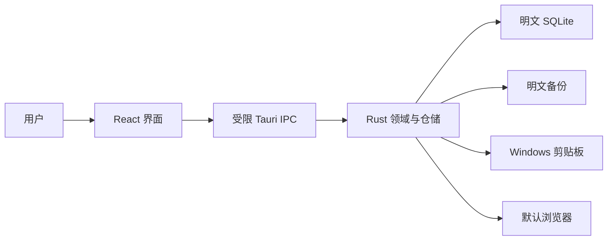

# 当前安全模型

> 状态：ADR-013 明文存储范围
>
> 最后更新：2026-08-01

## 定位

应用是无服务器、无账号、无同步的 Windows 本地账号信息管理工具。它使用普通 SQLite 和普通 SQLite 备份，没有主密码、锁定、解锁或应用层静态加密。

本版本仅用于虚构测试数据，不是可安全保存真实密码或 Token 的密码保险库。

## 提供的控制

- Tauri CSP、最小能力权限和无遥测/远程脚本边界。
- Rust 参数校验、SQLite 外键/事务/schema 标记和完整性检查。
- 敏感字段默认遮挡，列表与搜索响应不返回字段秘密。
- 用户主动复制；超时清理前确认剪贴板仍是应用写入的内容。
- 备份 SHA-256 清单、恢复前数据库检查和失败时不替换当前文件。
- 安装程序替换保护、显式数据清理路径和依赖审计。

## 不提供的保护

- `password-manager.db` 与 `plaintext-backups` 在磁盘上均未加密。
- 能读取当前用户文件的程序、恶意软件、管理员、磁盘镜像或备份系统可以读取全部数据。
- SHA-256 清单只检测意外变化；能够同时修改数据库和清单的攻击者可以绕过它。
- Windows 剪贴板历史、第三方剪贴板工具、屏幕录制、内存读取和系统转储可能保留副本。
- 应用没有锁定状态；切换应用、锁屏、睡眠或恢复不会隐藏已经打开的数据。
- 不承诺安全删除、设备丢失防护、发布者身份（未签名构建）或抵御已控制系统的攻击者。

## 信任边界

Windows 用户账号、NTFS 权限和设备安全是数据库的外部访问边界，不是应用提供的加密保证。

## 数据规则

- 开发、CI、截图、安装和恢复测试只能使用 `TEST-ONLY` 虚构数据与保留示例域名。
- 不在日志、测试报告、通知或错误信息中输出字段值。
- 不读取、迁移、覆盖或删除旧 `vault.db`、安全头和旧加密备份。
- 若未来重新引入加密或身份验证，必须另立项目、威胁模型和 ADR；不得复活旧锁定入口作为隐式增量。
