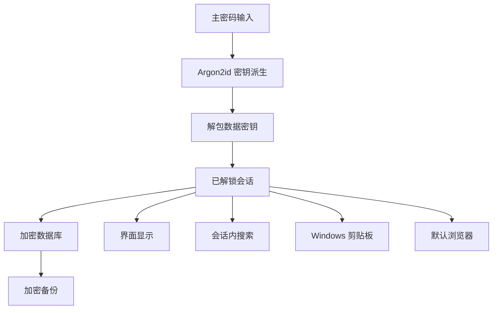

# 威胁模型

> 用途说明：识别本地密码管理器的攻击者、数据流、主要威胁、控制措施、残余风险和测试要求。
>
> 状态：第一阶段内部评审完成 / 第二阶段威胁控制待实现
>
> 最后更新日期：2026-07-30

## 1. 范围

本威胁模型针对：

- Windows 本地桌面应用。
- 单用户、单保险库。
- 一个 `Setup.exe` 安装入口。
- 无服务器、无云同步、无浏览器扩展。
- 加密保险库、手动或自动锁定、剪贴板和本地备份。

不包含远程 API、团队共享和移动端威胁。

## 2. 攻击者

| 攻击者 | 能力 |
| --- | --- |
| 获得保险库文件的人 | 可无限复制文件并离线猜测主密码 |
| 获得丢失设备的人 | 可读取用户文件，可能尝试登录 Windows |
| 同一 Windows 账号下的普通程序 | 可能读取剪贴板、用户可访问文件和窗口内容 |
| 篡改下载文件的攻击者 | 尝试替换安装包或发布文件 |
| 恶意导入文件提供者 | 构造损坏、超大或异常数据 |
| 低权限本地攻击者 | 尝试利用文件权限、路径或协议处理漏洞 |

具有管理员、调试或内核权限且在保险库解锁时读取进程内存的攻击者属于明确残余风险。

## 3. 数据流

敏感数据越过边界时必须有明确用户动作或受控服务调用。

## 4. 风险等级

| 等级 | 解释 |
| --- | --- |
| 严重 | 可直接读取大量秘密、绕过主密码或破坏全部数据 |
| 高 | 可读取单个秘密、持久泄露或导致难以恢复的数据损坏 |
| 中 | 需要较强前置条件、泄露有限元数据或造成可恢复故障 |
| 低 | 影响有限、容易发现且可恢复 |

公开版本存在未处理的严重或高风险问题时不得发布。

## 5. 主要威胁

### T-001 保险库文件被复制

- 风险：严重。
- 场景：攻击者获得数据库和安全头，在其他设备离线分析。
- 控制：随机盐、Argon2id、随机数据密钥、认证加密、强主密码提示。
- 测试：文件中搜索不到已知秘密；错误主密码和篡改均失败。
- 残余风险：弱主密码仍可能被离线穷举。

### T-002 主密码离线穷举

- 风险：严重。
- 场景：攻击者反复尝试候选密码解包数据密钥。
- 控制：内存困难 KDF、每个保险库随机盐、可升级参数、较长主密码建议。
- 不采用：本地失败次数锁定作为主要防线，因为攻击者可绕过应用直接离线计算。
- 残余风险：用户选择弱密码时无法完全防止。

### T-003 数据库篡改

- 风险：高。
- 场景：修改密文页面、头信息、对象关系或版本。
- 控制：数据库页完整性、密钥包装 AEAD、受认证的关键头字段、结构校验和事务。
- 测试：随机翻转头、包装密钥和数据库字节必须导致明确失败。

### T-004 回滚到旧保险库

- 风险：中。
- 场景：攻击者或误操作用旧副本替换当前文件。
- 控制：显示备份时间、版本和恢复确认；迁移前后保留明确恢复点。
- 残余风险：完全离线且无可信外部计数器时，无法可靠检测所有合法旧副本回滚。

### T-005 主密码进入日志或配置

- 风险：严重。
- 场景：调试输出、错误对象或崩溃报告包含输入。
- 控制：敏感类型、禁止调试格式、日志脱敏、测试扫描。
- 测试：设置、错误密码、崩溃路径和诊断包中检索测试主密码。

### T-006 数据密钥泄露

- 风险：严重。
- 场景：密钥被写入日志、临时文件、交换文件或长时间保留。
- 控制：只在解锁会话内保存、敏感容器、尽力清零、不序列化、不复制到 UI。
- 残余风险：高权限内存读取和操作系统换页。

### T-007 解锁后界面残留

- 风险：高。
- 场景：锁定后通过返回、缓存页面或旧窗口继续查看密码。
- 控制：集中会话门控、锁定事件清空路由和状态、所有敏感命令再次检查。
- 测试：锁定后尝试返回、快捷键、旧弹窗和复制。

### T-008 剪贴板泄露

- 风险：高。
- 场景：其他应用或剪贴板历史读取密码。
- 控制：用户主动复制、定时清除、条件清除、风险说明。
- 残余风险：复制后到清除前的窗口，以及系统或第三方历史记录。

### T-009 明文临时文件

- 风险：严重。
- 场景：数据库解密、恢复或导出时留下明文副本。
- 控制：数据库保持加密；恢复在受控临时路径；失败清理；普通操作不生成明文文件。
- 测试：创建、保存、搜索、备份和恢复后扫描应用目录及临时目录。

### T-010 搜索索引泄露

- 风险：高。
- 场景：建立用户名、Token 或密码的明文磁盘索引。
- 控制：MVP 只在解锁会话中搜索；秘密字段不持久化索引；锁定清理。

### T-011 危险网址协议

- 风险：高。
- 场景：恶意数据使用 `file:`、`javascript:` 或系统协议触发本地行为。
- 控制：只允许 `https` 和经提示的 `http`；解析后再调用系统；不执行命令字符串。
- 测试：危险协议、转义、空白和混淆输入。

### T-012 安装包被替换

- 风险：严重。
- 场景：用户下载到植入恶意代码的同名 `.exe`。
- 控制：HTTPS 发布渠道、代码签名、校验值、固定发布者身份、发布记录。
- 残余风险：用户忽略签名错误或从非官方渠道下载。

### T-013 依赖或构建链受损

- 风险：严重。
- 场景：第三方依赖、构建脚本或发布环境被植入恶意代码。
- 控制：锁定依赖、最小依赖、审查关键库、自动化构建、产物溯源和最小发布权限。

### T-014 恶意导入或备份文件

- 风险：高。
- 场景：超大字段、畸形版本、路径穿越、关系环或资源耗尽。
- 控制：大小限制、严格解析、版本检查、无脚本执行、临时位置验证、事务导入。

### T-015 数据库损坏或写入中断

- 风险：高。
- 场景：断电、磁盘满、杀进程或迁移失败。
- 控制：事务、WAL 策略评审、原子替换、迁移前备份、完整性检查。
- 测试：模拟磁盘满、异常关闭和字节损坏。

### T-016 卸载误删数据

- 风险：高。
- 场景：用户卸载应用时保险库被一并删除。
- 控制：卸载默认保留用户数据；删除数据使用独立确认流程。

### T-017 UI 注入或 WebView 内容执行

- 风险：严重。
- 场景：网站名、备注或字段值被当作 HTML 执行。
- 控制：框架默认文本转义、禁止渲染用户 HTML、严格内容安全策略、不开启不必要远程内容。
- 测试：脚本、HTML、SVG 和 URL 载荷作为普通文本显示。

### T-018 高权限恶意软件

- 风险：严重但超出可靠防护范围。
- 场景：管理员恶意软件读取键盘、进程内存或屏幕。
- 控制：减少解锁时间、自动锁定、签名发布、用户说明。
- 残余风险：无法在同一已受控操作系统内建立绝对隔离。

## 6. 不采用的控制

- 不使用联网服务器保存主密码验证结果。
- 不依赖失败次数锁定抵御离线攻击。
- 不把隐藏算法或文件格式当作安全措施。
- 不使用自签名证书让普通用户建立错误信任。
- 不把 Windows 登录密码或 DPAPI 作为唯一保险库主密钥，因为需要用户控制和备份可携带性。
- 不在 MVP 实现复杂反调试或代码混淆来代替密码学保护。

## 7. 隐私威胁

即使密码安全，以下信息泄露也可能伤害用户：

- 使用过哪些网站。
- 分类和账号名称。
- 账号数量。
- 更新时间和使用习惯。
- 搜索词。

因此这些元数据默认加密，不记录最近使用和搜索历史，不默认发送遥测。

## 8. 验证计划

| 类别 | 必须测试 |
| --- | --- |
| 离线文件 | 明文扫描、错误密码、参数篡改、密文篡改 |
| 会话 | 锁定、返回、快捷键、并发窗口、休眠 |
| 内存与日志 | 密钥不序列化、日志扫描、崩溃路径 |
| 剪贴板 | 复制正确性、定时清除、条件清除 |
| URL | 允许协议、危险协议、解析混淆 |
| 数据完整性 | 异常退出、磁盘满、迁移失败、损坏 |
| 发布 | 签名验证、校验值、依赖清单 |
| UI | 用户输入按文本渲染、CSP、无远程脚本 |

## 9. 评审触发条件

增加以下任一能力时必须重做相关威胁分析：

- 自动更新。
- 联网图标下载。
- 导入第三方密码库。
- 浏览器扩展或自动填充。
- 云同步。
- 多保险库。
- 生物识别或 Windows Hello 快速解锁。
- 动态插件。
- 附件。

## 10. 待决策事项

- [ ] 技术栈确定后完成 WebView 和 IPC 专项威胁分析。
- [ ] 确定安装包签名与发布渠道。
- [ ] 确定数据库损坏检测和恢复工具。
- [ ] 确定是否禁用屏幕截图的可行性与实际价值。
- [ ] 在原型上验证锁定后的内存和 UI 清理。

## 11. 相关文档

- [第一阶段安全评审](PHASE_1_SECURITY_REVIEW.md)
- [安全模型](SECURITY_MODEL.md)
- [加密设计](ENCRYPTION_DESIGN.md)
- [剪贴板安全](CLIPBOARD_SECURITY.md)
- [敏感数据处理](SENSITIVE_DATA_HANDLING.md)
- [安全测试计划](SECURITY_TEST_PLAN.md)
- [依赖策略](../08-development/DEPENDENCY_POLICY.md)
