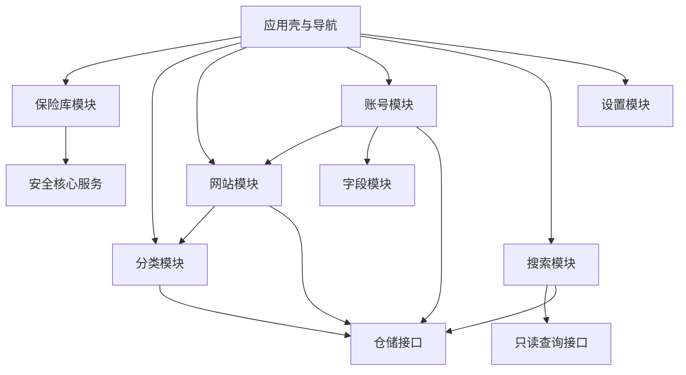

# 模块架构

> 用途说明：定义模块边界、依赖、注册、生命周期、通信、数据权限和测试方式，落实“功能先模块化再接入主程序”原则。
>
> 状态：初稿 / 待架构评审
>
> 最后更新日期：2026-07-30

## 1. 模块化定义

模块是具有以下特征的功能单元：

- 单一明确职责。
- 公开用例或查询接口。
- 私有实现和数据访问细节。
- 明确依赖。
- 生命周期。
- 独立测试。
- 对敏感数据的最小权限。

MVP 的模块是编译期模块，不是用户可安装插件。动态插件系统不进入当前范围。

## 2. 模块层次



应用壳只负责组合模块和导航，不实现业务逻辑。

## 3. 核心模块

| 模块 | 职责 | MVP |
| --- | --- | --- |
| 应用壳 | 启动、导航、全局错误、模块组合 | 是 |
| 保险库 | 创建、解锁、锁定和会话状态 | 是 |
| 分类 | 分类增删改查和排序 | 是 |
| 网站 | 网站信息、归属、账号摘要和网址 | 是 |
| 账号 | 多账号、账号编辑和删除 | 是 |
| 自定义字段 | 字段类型、排序、敏感属性和校验 | 是 |
| 搜索 | 解锁后安全查询和结果定位 | 是 |
| 剪贴板 | 复制和定时条件清除 | MVP 基础，V1 完整 |
| 网址启动 | 网址校验和默认浏览器调用 | 是 |
| 设置 | 非敏感配置和安全默认值 | V1 |
| 备份 | 一致性备份和恢复 | V1 |
| 标签 | 标签和关联 | V1 候选 |
| 收藏 | 常用对象入口 | V1 候选 |
| 密码生成器 | 本地密码生成 | 后续 |
| 导入导出 | 格式解析和风险流程 | 后续 |

## 4. 基础设施不是业务模块

以下能力以共享接口或基础设施实现存在：

- 加密与密钥管理。
- SQLCipher 连接和事务。
- 时间和随机数。
- 日志。
- Windows Known Folder。
- 原子文件操作。
- Tauri 命令适配。

它们不能被包装成可以任意绕过业务规则的“万能模块”。

## 5. 模块结构

每个业务模块建议包含：

```text
module-name/
├─ domain/          模块实体、值对象和规则
├─ application/     命令、查询和用例
├─ ports/           仓储及外部服务接口
├─ infrastructure/  接口实现，可按项目结构集中
├─ ui/              页面、组件和前端状态
└─ tests/           单元与集成测试
```

前后端可以位于不同顶层目录，但模块名称和职责保持对应。

## 6. 模块清单

模块注册信息建议包含：

| 字段 | 说明 |
| --- | --- |
| `id` | 稳定模块标识 |
| `version` | 模块内部版本，MVP 可跟随应用版本 |
| `dependencies` | 直接依赖模块 |
| `commands` | 对外应用用例 |
| `queries` | 对外只读查询 |
| `events` | 发布或订阅的事件类型 |
| `routes` | 前端页面入口 |
| `requiredSession` | 是否要求保险库解锁 |

编译期注册表由应用组合根维护。模块不能在运行时自行扫描和加载未知 DLL。

## 7. 公开接口

模块公开：

- 类型化命令。
- 类型化查询。
- 领域或应用事件。
- 最小数据视图。

模块不公开：

- 数据库连接。
- SQL 字符串。
- 私有表结构。
- DEK、KEK 或主密码。
- 可任意读取整个保险库的接口。
- 前端组件内部状态。

## 8. 命令与查询

### 8.1 命令

用于改变状态，例如：

- `CreateCategory`
- `CreateWebsite`
- `CreateAccount`
- `UpdateAccountFields`
- `DeleteWebsite`
- `LockVault`

命令：

- 在应用层检查会话。
- 通过领域规则校验。
- 使用明确事务。
- 返回成功标识或稳定错误。

### 8.2 查询

用于读取安全视图，例如：

- `ListCategories`
- `ListWebsitesByCategory`
- `GetAccountSummary`
- `GetAccountFields`
- `SearchEntries`

列表查询不默认返回敏感字段值。

## 9. 数据所有权

| 数据 | 主要负责模块 |
| --- | --- |
| 保险库安全头和会话 | 保险库 / 安全服务 |
| 分类 | 分类 |
| 网站 | 网站 |
| 账号 | 账号 |
| 账号字段 | 自定义字段，与账号事务协作 |
| 搜索结果 | 搜索，只读 |
| 剪贴板状态 | 剪贴板 |
| 设置 | 设置 |
| 删除批次 | 数据生命周期服务与对象模块协作 |

“负责”不代表独占数据库表，而表示修改规则必须通过该模块。

## 10. 依赖规则

允许：

- 账号依赖网站存在性接口。
- 网站依赖分类存在性接口。
- 搜索依赖只读查询接口。
- 所有敏感模块依赖保险库会话接口。
- 业务模块依赖仓储端口。

禁止：

- 分类模块直接修改网站私有数据。
- 搜索模块绕过仓储读取数据库文件。
- UI 模块直接调用 SQLCipher。
- 设置模块读取 DEK。
- 模块之间循环依赖。
- 通过全局可变对象共享解密数据。

## 11. 跨模块流程

### 11.1 删除分类

1. 分类模块请求网站模块计算影响。
2. 应用层组合影响摘要。
3. 用户明确确认。
4. 数据生命周期服务在一个事务中创建删除批次。
5. 分类、网站、账号和字段进入删除状态。
6. 发布不含敏感值的删除完成事件。

### 11.2 保存账号

1. 账号模块验证账号。
2. 字段模块验证字段。
3. 应用用例组合变更。
4. 数据层在一个事务中保存。

### 11.3 搜索

1. 搜索模块检查会话。
2. 通过只读查询端口匹配允许字段。
3. 返回安全摘要。
4. 用户进入详情时由账号模块按需读取。

## 12. 事件

事件只用于“已经发生”的事实，不用于代替必须立即成功的事务。

允许事件示例：

- `VaultLocked`
- `CategoryChanged`
- `WebsiteChanged`
- `AccountChanged`
- `EntityDeleted`

规则：

- 事件不包含字段值、主密码或密钥。
- 事件处理失败不应回滚已经提交的核心事务，除非使用明确事务内机制。
- 需要强一致的操作直接调用应用接口。
- 锁定事件必须同步通知所有敏感模块清理状态。

## 13. 生命周期

```text
Register → Initialize → Ready → Active/Locked-aware → Shutdown
```

- `Register`：组合根验证模块标识和依赖。
- `Initialize`：建立路由、命令和所需服务。
- `Ready`：可以响应非敏感请求。
- `Active`：保险库解锁后允许敏感用例。
- `Shutdown`：停止任务、关闭连接、清理状态。

业务模块不自行延长解锁会话或阻止全局锁定。

## 14. 可启用与不可关闭模块

MVP 中不可关闭：

- 应用壳。
- 保险库。
- 安全核心。
- 分类、网站、账号和字段。
- 数据访问。

可以在未来配置关闭：

- 标签。
- 收藏。
- 密码生成器。
- 图标下载。
- 导入导出入口。

关闭可选模块不能导致已有核心数据无法读取。

## 15. 前端模块状态

- 使用模块局部状态管理编辑和列表。
- 解锁会话状态由全局只读门控提供。
- 不把主密码或秘密持久化到浏览器存储。
- 锁定事件清空所有敏感模块状态。
- 跨模块共享对象只使用标识和安全摘要。
- 用户输入以文本渲染。

## 16. 后台任务

允许的短任务：

- KDF。
- 数据库查询。
- 备份。
- 数据迁移。
- 剪贴板定时清除。

规则：

- 任务受应用进程生命周期管理。
- 不安装系统后台服务。
- 锁定时取消不再安全的任务。
- 任务错误通过稳定通道报告。
- 不在后台悄悄联网。

## 17. 新模块接入流程

1. 在功能清单中定义用户问题和版本。
2. 编写模块设计文档。
3. 明确数据所有权和敏感数据范围。
4. 定义命令、查询和事件。
5. 声明依赖并检查无循环。
6. 实现模块单元测试。
7. 实现必要集成测试。
8. 在组合根注册。
9. 接入导航或设置。
10. 更新威胁模型、数据模型和文档。

## 18. 测试要求

每个模块至少测试：

- 领域规则。
- 未解锁访问拒绝。
- 正常命令和查询。
- 存储失败。
- 锁定事件清理。
- 不返回越权敏感数据。
- 与依赖模块的契约。

模块架构测试：

- 依赖图无循环。
- 领域层无基础设施依赖。
- Tauri 命令只调用应用用例。
- SQL 只存在于数据基础设施。

## 19. 架构验收

- [ ] 每项 MVP 功能具有明确模块所有者。
- [ ] 应用壳不实现业务规则。
- [ ] 模块公开接口不暴露数据库或密钥。
- [ ] 保存账号和字段使用单一事务用例。
- [ ] 删除影响通过跨模块应用流程协调。
- [ ] 搜索只使用安全只读接口。
- [ ] 锁定可以清空全部敏感模块状态。
- [ ] 新模块接入不要求修改所有现有模块。

## 20. 待决策事项

- [ ] 确定前端状态库后补充模块状态规范。
- [ ] 确定 Rust 模块和 crate 边界。
- [ ] 确定事件总线采用同步分发还是轻量异步通道。
- [ ] 确定收藏和标签的模块所有权。
- [ ] 确定备份模块是否允许解锁后后台运行。

## 21. 相关文档

- [系统架构](SYSTEM_ARCHITECTURE.md)
- [依赖规则](DEPENDENCY_RULES.md)
- [模块生命周期](MODULE_LIFECYCLE.md)
- [模块接口](MODULE_INTERFACE.md)
- [事件系统](EVENT_SYSTEM.md)
- [模块开发指南](../08-development/MODULE_DEVELOPMENT_GUIDE.md)
- [各模块设计](../06-modules/CATEGORY_MODULE.md)
