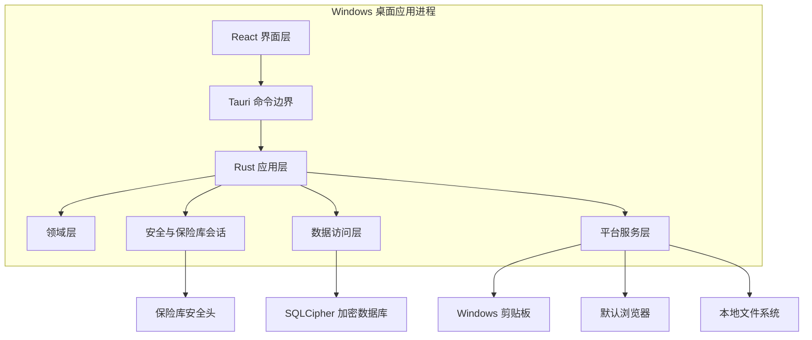
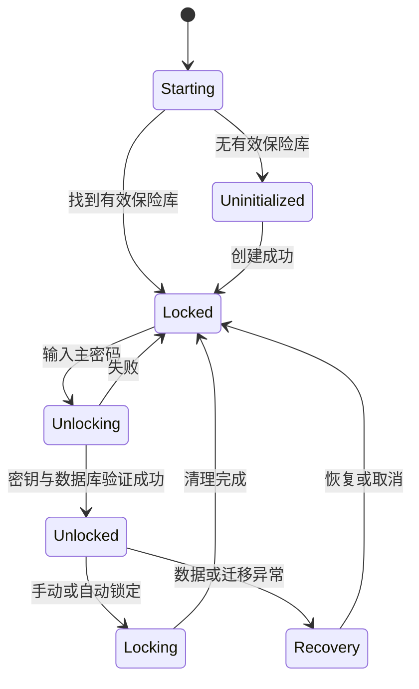
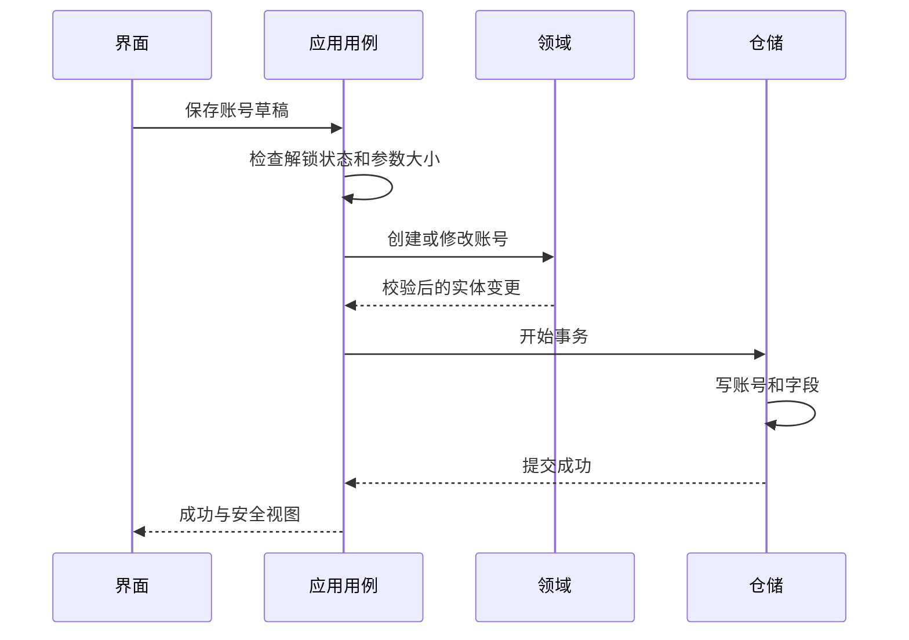

# 系统架构

> 用途说明：定义 Windows 本地桌面应用的运行结构、分层、进程边界、数据流、依赖方向、启动锁定流程和部署边界。
>
> 状态：历史 M1/M2 架构草案 / 密钥和锁定流程已由 ADR-014 取代
>
> 最后更新日期：2026-07-30

> 现行说明：本文保留早期主密码、KEK/DEK 和安全头方案供追溯。当前运行架构以 ADR-014、当前加密设计、存储实现和 M4 计划为准；本文中的 KDF、包装密钥、锁定及解锁流程不再构成实现要求。

## 1. 架构目标

- 完全本地、核心功能离线。
- Windows 用户只需运行一个 `Setup.exe` 安装程序。
- 界面、业务规则、安全和存储清晰分层。
- 主密码、KEK 和 DEK 不进入前端长期状态。
- 分类、网站、账号、字段和搜索以独立模块组织。
- 新功能通过模块和稳定接口接入，不修改无关核心。
- MVP 保持单进程、无后台服务、无动态插件。
- 数据写入、迁移和恢复具备明确失败边界。

## 2. 总体结构



界面和 Rust 后端运行在同一个桌面应用进程中，但仍视为不同信任区域。前端不能直接打开数据库、调用任意文件系统或持有数据库密钥。

## 3. 进程与部署模型

### 3.1 MVP

- 一个桌面应用进程。
- 不安装 Windows 服务。
- 不安装驱动。
- 不创建常驻托盘后台进程，除非以后通过需求评审。
- 不启动本地 HTTP 服务器。
- 不需要 Docker。
- 不依赖外部数据库进程。

### 3.2 安装

- 发布一个 `WebPasswordManager-Setup-x.y.z.exe`。
- 安装器负责程序文件、快捷方式和卸载入口。
- 应用数据与安装目录分离。
- 卸载默认保留保险库。
- 正式发布文件签名并提供校验值。

### 3.3 应用数据

建议逻辑位置：

```text
%LOCALAPPDATA%\WebPasswordManager\
├─ vault\
│  ├─ header
│  └─ vault.db
├─ config\
│  └─ settings.json
├─ logs\
└─ recovery\
```

实际路径通过 Windows Known Folder API 获取。目录名在正式产品命名后调整。

## 4. 分层

### 4.1 界面层

职责：

- 展示锁定、分类、网站、账号、搜索和设置界面。
- 收集用户输入。
- 管理非持久化交互状态。
- 呈现应用层返回的安全数据视图。

禁止：

- 直接执行 SQL。
- 保存主密码到 localStorage 或持久化状态。
- 持有 KEK 或 DEK。
- 把用户内容当 HTML 渲染。
- 自行决定安全和删除规则。

### 4.2 命令边界

职责：

- 暴露最小、类型化、显式允许的 Tauri 命令。
- 验证参数大小和结构。
- 将前端请求转换为应用用例。
- 返回稳定错误代码和最小响应。

禁止提供：

- 任意 SQL 命令。
- 任意文件读写命令。
- 任意 Shell 命令。
- 返回整个保险库的调试命令。
- 导出密钥的命令。

### 4.3 应用层

职责：

- 编排创建、解锁、保存、搜索、复制和删除等用例。
- 检查保险库会话状态。
- 建立事务边界。
- 调用领域规则、数据仓储和平台服务。
- 将领域错误映射为用户可理解错误。

### 4.4 领域层

职责：

- 定义实体、值对象、关系和不变量。
- 验证名称、系统字段角色和删除影响。
- 不依赖 Tauri、React、SQLite 或 Windows API。

### 4.5 安全层

职责：

- Argon2id 密钥派生。
- DEK 生成、包装和解包。
- 解锁会话和锁定。
- 敏感内存容器。
- 安全头读取、验证和原子更新。

安全层只通过窄接口向应用层提供能力，不返回密钥。

### 4.6 数据层

职责：

- SQLCipher 连接和事务。
- 仓储实现。
- 数据库结构版本和迁移。
- 软删除、排序和查询。
- 一致性快照和备份协作。

数据层不能自行绕过领域校验向界面返回秘密。

### 4.7 平台服务层

职责：

- Windows 剪贴板。
- 默认浏览器。
- Known Folder 和文件选择。
- 原子文件替换。
- 应用窗口和系统锁屏事件。

每种平台能力通过接口封装，便于测试和未来跨平台替换。

## 5. 依赖方向

```text
UI → Command/API → Application → Domain
                           ├────→ Security interfaces
                           ├────→ Repository interfaces
                           └────→ Platform interfaces

Infrastructure implements Security / Repository / Platform interfaces.
Domain does not depend on infrastructure.
```

约束：

- 依赖只能向内指向稳定规则。
- 领域层不能引用界面或数据库类型。
- 模块之间通过公开用例、查询或事件通信。
- 不允许模块读取另一个模块的私有表实现。

## 6. 核心运行状态



状态由 Rust 后端会话管理器掌握，前端路由不能自行将状态改为已解锁。

## 7. 启动流程

1. 初始化最小日志，确保默认脱敏。
2. 解析应用数据 Known Folder。
3. 加载非敏感配置并验证范围。
4. 检查保险库文件是否存在及结构是否完整。
5. 如果不存在，进入创建界面。
6. 如果存在，仅读取受限安全头并进入锁定界面。
7. 不在启动时自动解锁或读取业务数据。

## 8. 解锁流程

1. 前端收集主密码并通过单一命令提交。
2. 命令处理器检查长度和当前状态。
3. 安全服务读取头、执行 Argon2id 并解包 DEK。
4. 数据层用 DEK 打开 SQLCipher。
5. 验证数据库完整性、结构版本和验证标记。
6. 建立解锁会话。
7. 返回最小主页摘要。
8. 清理前端密码输入及 Rust 侧临时 KEK。

失败时关闭连接、清理临时密钥并保持锁定。

## 9. 锁定流程

1. 会话管理器拒绝新敏感命令。
2. 取消或安全完成正在运行的查询。
3. 清理前端详情、编辑和搜索状态。
4. 关闭数据库连接。
5. 清理 DEK 和缓存。
6. 清空敏感路由历史。
7. 通知界面进入锁定页。

所有敏感命令都必须在执行时再次检查会话，不能只依赖路由保护。

## 10. 保存流程



事务失败时不返回成功，保留最后一个有效版本。

## 11. 查询与搜索

- 列表查询返回非敏感摘要。
- 密码值不随账号列表返回。
- 用户打开详情时按需获取字段。
- 敏感字段默认返回遮挡状态；实际显示需要显式命令。
- MVP 搜索在解锁会话中执行，不创建秘密明文磁盘索引。
- 查询分页或上限在数据库设计中定义。

## 12. 错误边界

错误分为：

- 输入错误。
- 业务冲突。
- 锁定或会话错误。
- 存储和磁盘错误。
- 数据损坏。
- 版本不兼容。
- 密码学错误。
- 平台服务错误。

前端接收稳定错误代码和安全消息。内部原因可以写入脱敏日志，但不能包含秘密或完整对象。

## 13. 网络边界

- 应用不创建通用 HTTP 客户端模块。
- CSP 禁止远程脚本和不必要的远程资源。
- 网站内容不在应用 WebView 中打开。
- 用户点击打开网址时交给系统默认浏览器。
- 自动更新、Favicon 和遥测不进入 MVP。

## 14. 配置

非敏感配置使用独立文件：

- 主题。
- 窗口状态。
- 自动锁定时间。
- 剪贴板清除时间。

要求：

- 使用安全默认值。
- 验证范围。
- 不包含主密码、密钥或账号数据。
- 损坏时回退到安全默认值，不影响保险库。

## 15. 备份与恢复

- 备份模块向数据层请求一致性快照。
- 不通过前端传输完整数据库内容。
- 用户通过文件选择器决定目标。
- 恢复在临时位置验证后原子替换。
- 当前有效保险库在恢复成功前保持可用。

## 16. 目录结构候选

```text
src/
├─ ui/
│  ├─ app/
│  ├─ modules/
│  └─ shared/
└─ src-tauri/
   └─ src/
      ├─ application/
      ├─ domain/
      ├─ modules/
      ├─ security/
      ├─ storage/
      ├─ platform/
      └─ commands/
```

最终目录由技术栈文档和项目结构文档确认。

## 17. 架构质量门槛

- [ ] 前端不能直接访问数据库和任意文件系统。
- [ ] 领域层不依赖 Tauri、React、SQLite 或 Windows。
- [ ] DEK 和 KEK 不进入 WebView。
- [ ] 所有敏感命令执行时检查解锁会话。
- [ ] 账号和字段使用同一事务保存。
- [ ] 模块依赖不存在循环。
- [ ] 用户输入以文本渲染，不执行 HTML。
- [ ] 核心流程离线测试通过。
- [ ] 应用不启动后台服务或本地服务器。

## 18. 待决策事项

- [ ] SQLCipher Windows 原型确认后冻结存储实现。
- [ ] 确定 Tauri IPC 敏感值传递的最小结构。
- [ ] 确定自动锁定对休眠和系统锁屏事件的响应。
- [ ] 确定列表查询分页阈值。
- [ ] 确定应用数据目录和保险库容器形式。

## 19. 相关文档

- [模块架构](MODULE_ARCHITECTURE.md)
- [分层架构](LAYERED_ARCHITECTURE.md)
- [依赖规则](DEPENDENCY_RULES.md)
- [服务接口](SERVICE_INTERFACES.md)
- [技术栈](TECH_STACK.md)
- [数据模型](../02-domain-and-data/DATA_MODEL.md)
- [安全模型](../04-security/SECURITY_MODEL.md)
- [数据库设计](../03-storage/DATABASE_DESIGN.md)
