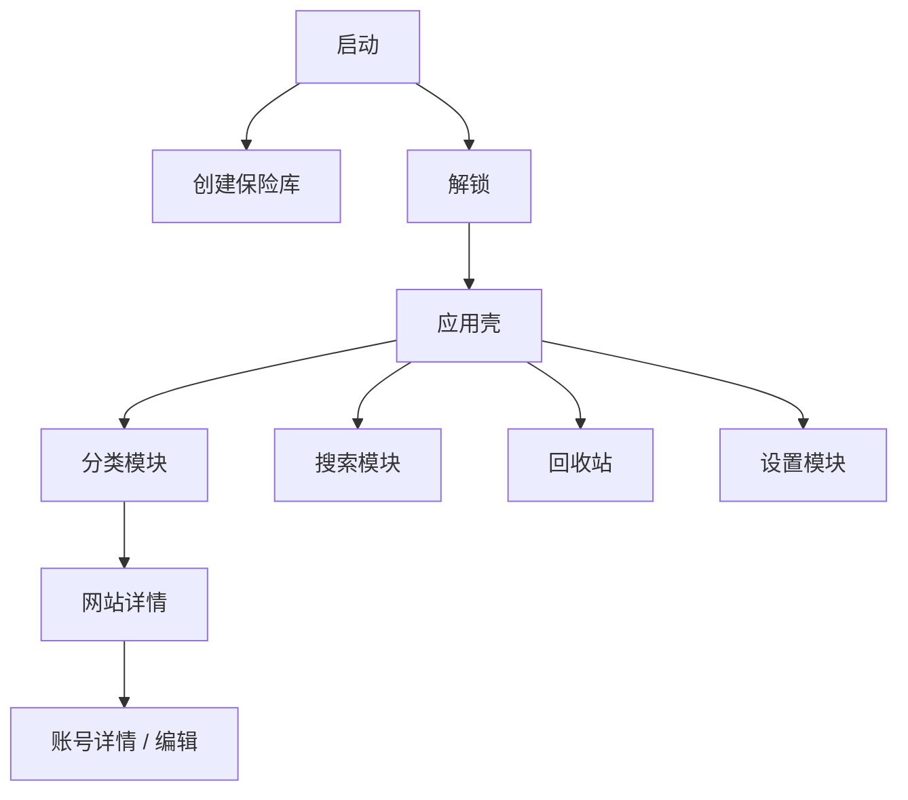

# 界面架构

> 用途说明：定义桌面应用壳、页面模块、路由、状态、数据获取、安全边界、响应式布局和组件层次。
>
> 状态：初稿 / 待界面原型评审
>
> 最后更新日期：2026-07-30

## 1. 目标

- 模块化界面，不把所有编辑功能堆在首页。
- 常用查找、复制和打开网址保持高效。
- 锁定与解锁状态清晰且不可由路由绕过。
- 敏感字段默认隐藏。
- 危险操作与普通操作明显区分。
- 适合 Windows 键盘、鼠标和中等尺寸桌面窗口。

## 2. 界面层级



保险库未解锁时不渲染主应用业务路由。

## 3. 应用壳

解锁后界面由三个稳定区域组成：

```text
┌────────────┬──────────────────────────────────────────┐
│ 主导航     │ 顶部栏：当前位置 / 搜索 / 锁定          │
│            ├──────────────────────────────────────────┤
│ 分类       │ 当前模块内容                             │
│ 搜索       │                                          │
│ 回收站     │                                          │
│ 设置       │                                          │
│            │                                          │
│ [锁定]     │                                          │
└────────────┴──────────────────────────────────────────┘
```

- 主导航固定在左侧。
- 顶部栏保留全局搜索和锁定。
- 中间区域只展示当前模块。
- 网站详情内部可以使用账号列表和详情双栏。

## 4. 路由

### 未解锁

- `/setup`
- `/unlock`
- `/recovery`

### 已解锁

- `/categories`
- `/categories/:categoryId`
- `/websites/:websiteId`
- `/websites/:websiteId/accounts/new`
- `/websites/:websiteId/accounts/:accountId`
- `/search`
- `/trash`
- `/settings`

规则：

- 锁定后清空已解锁路由历史并跳转 `/unlock`。
- 直接访问已解锁路由时，前端和 Rust 后端都检查会话。
- 路由参数只有稳定标识，不包含名称、用户名或秘密。

## 5. 页面模块

| 页面 | 主要内容 | 不包含 |
| --- | --- | --- |
| 创建保险库 | 主密码、确认、恢复限制 | 业务数据 |
| 解锁 | 主密码、错误反馈 | 分类和网站摘要 |
| 分类首页 | 分类列表、网站数量、新建入口 | 账号密码 |
| 分类详情 | 网站列表、筛选、新建网站 | 全部账号字段 |
| 网站详情 | 网站头、账号列表、选中账号详情 | 无关分类数据 |
| 账号编辑 | 账号名称、字段编辑、保存取消 | 其他账号秘密 |
| 搜索 | 查询、结果上下文 | 敏感值 |
| 回收站 | 删除批次、恢复、永久删除 | 活跃数据编辑 |
| 设置 | 安全行为、外观、数据位置 | 主密码和字段值 |

## 6. 模块状态

### 全局非敏感状态

- 当前会话是否锁定。
- 当前路由。
- 主题。
- 窗口尺寸。
- 全局通知。

### 模块局部状态

- 分类筛选。
- 网站列表。
- 当前账号编辑草稿。
- 搜索输入和结果。
- 回收站选择。

### 禁止持久化

- 主密码。
- 明文密码。
- Token。
- 完整账号详情。
- 搜索历史。
- DEK 或 KEK。

锁定事件清理所有敏感模块状态。

## 7. 数据获取

- 页面通过类型化前端服务调用 Tauri 命令。
- 列表只获取摘要。
- 详情按需获取。
- 显示敏感字段时按单字段、短生命周期读取。
- 复制可以优先由 Rust 直接写剪贴板，避免把秘密返回前端；原型验证可行性。
- 请求错误映射为稳定用户反馈。

## 8. 表单

- 编辑在草稿中进行。
- 保存前前端提示，Rust 领域层最终校验。
- 取消恢复最后成功状态。
- 页面有未保存内容时离开需要确认。
- 自动锁定发生时默认丢弃未保存敏感草稿；是否加密暂存待决策。
- 动态字段支持添加、排序、删除和敏感切换。

## 9. 敏感字段组件

组件状态：

- 隐藏。
- 临时显示。
- 复制中。
- 已复制。
- 错误。

规则：

- 默认隐藏。
- 显示和复制为独立按钮。
- 锁定后组件立即卸载或清空。
- 不把值放入 HTML 属性、URL、标题或 aria-label。
- 屏幕阅读器策略在无障碍文档细化。

## 10. 对话框

必须使用确认对话框：

- 删除非空分类。
- 删除网站。
- 删除账号。
- 永久删除回收站内容。
- 明文导出。
- 修改敏感字段为非敏感。
- 恢复备份覆盖当前保险库。

对话框显示影响摘要，不显示秘密。

## 11. 通知

- 成功：短暂 Toast。
- 输入错误：字段附近提示。
- 可恢复错误：页面内提示和重试。
- 数据损坏或迁移错误：阻断页面。
- 复制提示不显示实际内容。
- 同一错误避免重复弹出大量通知。

## 12. 键盘

首版目标：

- `Ctrl+K` 或 `/` 聚焦全局搜索，最终快捷键待确认。
- `Ctrl+L` 不使用，避免与浏览器习惯冲突。
- `Ctrl+S` 在编辑页保存。
- `Esc` 关闭弹窗或取消临时显示。
- 锁定提供可发现快捷键，避免误触。
- Tab 顺序与视觉顺序一致。

快捷键不能绕过确认和会话检查。

## 13. 布局适配

| 窗口宽度 | 布局 |
| --- | --- |
| ≥ 1280 px | 左导航 + 列表 + 详情多栏 |
| 960–1279 px | 左导航 + 主内容，详情使用内部双栏或独立页 |
| < 960 px | 最小支持布局，导航可折叠，详情独立页 |

建议最小窗口为 900 × 640。最终值通过原型测试。

本项目不是移动应用，不为手机尺寸牺牲桌面效率。

## 14. 组件层次

```text
App
├─ LockedApp
│  ├─ SetupScreen
│  └─ UnlockScreen
└─ UnlockedApp
   └─ AppShell
      ├─ PrimaryNavigation
      ├─ TopBar
      ├─ ModuleOutlet
      └─ GlobalFeedback
```

共享组件：

- `SensitiveField`
- `CopyButton`
- `ConfirmDialog`
- `EmptyState`
- `ErrorState`
- `EntityList`
- `SearchInput`
- `FieldEditor`

组件不得直接执行业务 SQL 或保存敏感数据。

## 15. 安全

- CSP 禁止远程脚本。
- 用户文本不使用 `dangerouslySetInnerHTML`。
- Tauri 能力使用最小权限。
- 不在前端日志打印请求和响应对象。
- 生产构建关闭开发工具入口，除非明确诊断模式。
- 锁定页不保留可通过 DOM 检查读取的业务内容。

## 16. 测试

- 路由在锁定状态下不可访问。
- 锁定清空详情和编辑状态。
- 敏感字段默认隐藏。
- 复制反馈不泄露值。
- 对话框键盘焦点被正确限制和恢复。
- 用户 HTML 载荷按纯文本显示。
- 900 × 640、1280 × 720 和 1920 × 1080 布局可用。

## 17. 待决策事项

- [ ] 确定最终路由库。
- [ ] 原型验证 Rust 直接复制秘密的交互方式。
- [ ] 确定最小窗口尺寸。
- [ ] 确定全局搜索和锁定快捷键。
- [ ] 确定未保存草稿遇到自动锁定的处理。
- [ ] 确定浅色与深色主题进入哪个版本。

## 18. 相关文档

- [信息架构](INFORMATION_ARCHITECTURE.md)
- [界面线框图](WIREFRAMES.md)
- [导航设计](NAVIGATION_DESIGN.md)
- [交互设计](INTERACTION_DESIGN.md)
- [组件库](COMPONENT_LIBRARY.md)
- [技术栈](../05-architecture/TECH_STACK.md)
- [系统架构](../05-architecture/SYSTEM_ARCHITECTURE.md)
